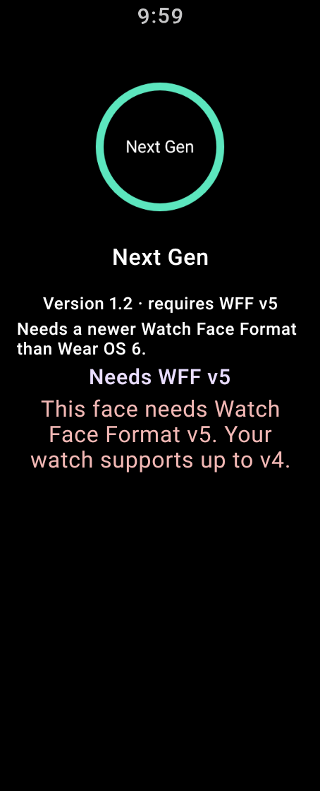

# :push-app

Wear OS 6 app that installs watch-face designs from the hosted site onto the watch with the
[Watch Face Push API](https://developer.android.com/training/wearables/watch-face-push)
(`androidx.wear.watchfacepush:watchfacepush:1.0.0`). Server contract: [`docs/PUSH_API.md`](../docs/PUSH_API.md).

| Link | Designs | Detail (replace) | Detail (WFF too new) |
| --- | --- | --- | --- |
|  |  |  |  |

## Naming rule and package

The app's applicationId, **`ee.schimke.watchface.push`**, is the *marketplace package*. Watch Face
Push only accepts APKs whose package is

```
ee.schimke.watchface.push.watchfacepush.<faceName>
```

It is defined once as `watchface.marketplacePackage` in the root `gradle.properties`; the packager
and the site must use the same value (and pass it as the validator's `--package_name`).

## Single slot on Wear OS 6

Wear OS 6 gives a marketplace **one** watch-face slot. So installing design B while design A is
installed *replaces* A (`updateWatchFace(slot, …)`), and the detail screen says so and asks for a
second tap ("Replace now"). Installing the same design again is an update. When a watch reports
free slots (`remainingSlotCount > 0`) a new design uses a free slot first; when full on a
multi-slot watch the slot with the lowest version code is replaced. Slot ids are never stored:
they are looked up from `listWatchFaces()` immediately before every operation.

After a successful install the app calls `setWatchFaceAsActive` if the runtime permission
`SET_PUSHED_WATCH_FACE_AS_ACTIVE` is granted; otherwise the result offers "Set as watch face",
which requests it. Google allows this API only once per marketplace; later refusals
(`ERROR_MAXIMUM_ATTEMPTS_REACHED`) tell the user to long-press their current face.

## Build

```sh
build-brief ./gradlew :push-app:assembleDebug     # needs Android SDK platform 37 (compileSdk 37)
build-brief ./gradlew :push-app:testDebugUnitTest # JDK 21 (Robolectric on SDK 36)
```

Optional properties: `-Ppush.baseUrl=https://…` (default `https://preview.coo.ee`) and
`-Ppush.fake=false` to make debug builds use the real server (debug defaults to the in-app fake).
Regenerate the README screenshots with `-PscreenshotDir=docs/screenshots` on the test task.

## Release to Google Play

Each repository release builds the app and, once `PLAY_PUBLISH` is set, publishes it to Play's
internal track with the listing in `src/main/play/`. Setup, secrets and versioning:
[`docs/PLAY_PUBLISHING.md`](../docs/PLAY_PUBLISHING.md).

## Run on an emulator (Wear OS 6)

1. Create an AVD from the *Wear OS 6 (API 36) Small Round* system image.
2. `./gradlew :push-app:installDebug`
3. Launch **Faces**. The debug build uses the fake server: the watch shows a code and QR; the fake
   approves after ~2 polls (no phone needed). Pointing at a real site instead:
   `adb shell am start -n ee.schimke.watchface.push/.MainActivity --es base_url https://<site> --ez fake false`
   then open the shown URL on a signed-in device and confirm.
4. Open a design and tap **Install**. The fake serves placeholder bytes with a valid SHA-256, so the
   download/verify path runs, but the system push service will reject them (no real validation
   token). To push a real face, run against a site that serves packager output.

Unlink from the bottom of the design list.

## Design notes

- `InstallFlow`: plan against slots → download → SHA-256 check → push. Corrupt downloads never
  reach the push API. `WatchFacePusher` wraps the library so flows are tested with a fake.
- Watch Face Format support: Google documents v1–v4 = API 33–36 but no runtime query, so it is
  derived from the SDK level (`WffSupport`; above API 36 is assumed v5). Designs needing a newer
  version are refused with a clear message.
- UI uses Wear Compose Material 3 (`androidx.wear.compose:compose-material3:1.7.1`); the device
  token is stored in DataStore, AES-GCM encrypted with an Android Keystore key.
