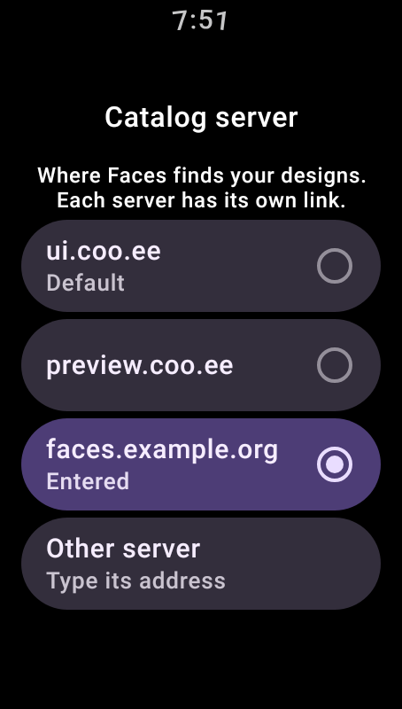
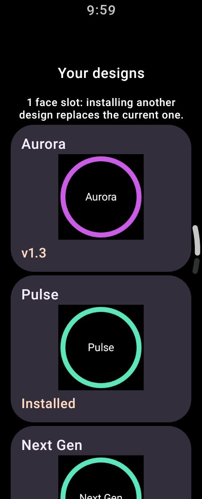
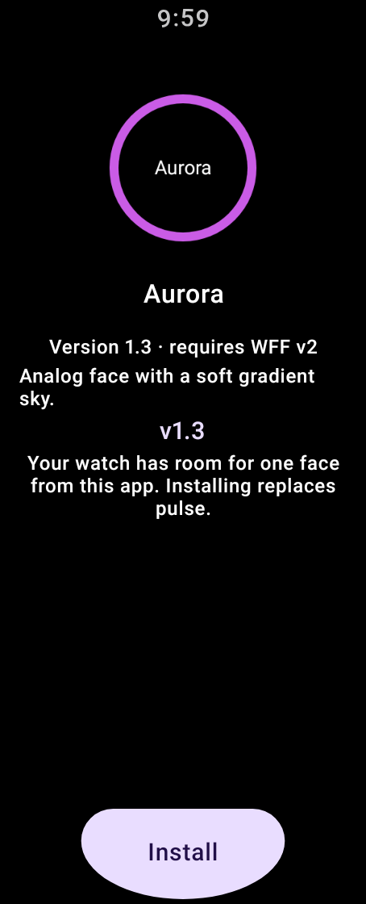

# :push-app

Wear OS 6 app that installs watch-face designs from the hosted site onto the watch with the
[Watch Face Push API](https://developer.android.com/training/wearables/watch-face-push)
(`androidx.wear.watchfacepush:watchfacepush:1.0.0`). Server contract: [`docs/PUSH_API.md`](../docs/PUSH_API.md).

| Link | Server | Designs | Detail (replace) | Detail (WFF too new) |
| --- | --- | --- | --- | --- |
|  |  |  |  |  |

## Naming rule and package

The app's applicationId, **`ee.schimke.watchface.push`**, is the *marketplace package*. Watch Face
Push only accepts APKs whose package is

```
ee.schimke.watchface.push.watchfacepush.<faceName>
```

It is defined once as `watchface.marketplacePackage` in the root `gradle.properties`; the packager
and the site must use the same value (and pass it as the validator's `--package_name`).

## Single slot on Wear OS 6

Wear OS 6 gives a marketplace **one** watch-face slot. So installing design B while design A is
installed *replaces* A (`updateWatchFace(slot, …)`), and the detail screen says so and asks for a
second tap ("Replace now"). Installing the same design again is an update. When a watch reports
free slots (`remainingSlotCount > 0`) a new design uses a free slot first; when full on a
multi-slot watch the slot with the lowest version code is replaced. Slot ids are never stored:
they are looked up from `listWatchFaces()` immediately before every operation.

After a successful install the app calls `setWatchFaceAsActive` if the runtime permission
`SET_PUSHED_WATCH_FACE_AS_ACTIVE` is granted; otherwise the result offers "Set as watch face",
which requests it. Google allows this API only once per marketplace; later refusals
(`ERROR_MAXIMUM_ATTEMPTS_REACHED`) tell the user to long-press their current face.

## Build

```sh
build-brief ./gradlew :push-app:assembleDebug     # needs Android SDK platform 37 (compileSdk 37)
build-brief ./gradlew :push-app:testDebugUnitTest # JDK 21 (Robolectric on SDK 36)
```

Optional properties: `-Ppush.baseUrl=https://…` (default `https://ui.coo.ee`), `-Ppush.servers=a,b`
(the server picker's list; default `ui.coo.ee` and `preview.coo.ee`; see
[`docs/PUSH_API.md`](../docs/PUSH_API.md#catalog-servers)) and
`-Ppush.fake=false` to make debug builds use the real server (debug defaults to the in-app fake).
Regenerate the README screenshots with `-PscreenshotDir=docs/screenshots` on the test task.

## Release to Google Play

Each repository release builds the app and, once `PLAY_PUBLISH` is set, publishes it to Play's
internal track with the listing in `src/main/play/`. Setup, secrets and versioning:
[`docs/PLAY_PUBLISHING.md`](../docs/PLAY_PUBLISHING.md).

## Run on an emulator (Wear OS 6)

1. Create an AVD from the *Wear OS 6 (API 36) Small Round* system image.
2. `./gradlew :push-app:installDebug`
3. Launch **Faces**. **Browse public faces** lists the server's public designs with no account.
   Or link: the debug build uses the fake server, so the watch shows a code and QR and the fake
   approves after ~2 polls (no phone needed). Linking adds the account's private designs (`Pulse`
   in the fake). Pointing at a real site instead:
   `adb shell am start -n ee.schimke.watchface.push/.MainActivity --es base_url https://<site> --ez fake false`
   then open the shown URL on a signed-in device and confirm.
4. Open a design and tap **Install**. The fake serves placeholder bytes with a valid SHA-256, so the
   download/verify path runs, but the system push service will reject them (no real validation
   token). To push a real face, run against a site that serves packager output.

Unlink from the bottom of the design list.

## Emulator test in CI

`.github/workflows/push-app-emulator.yml` runs the app on a Wear OS 6 (API 36) emulator on every
`push-app/**` change, and on demand. It is not a required check. It drives the UI with
`uiautomator dump` + `adb shell input` (`.github/scripts/emulator/push_app_e2e.py`), uploads a
screenshot per step plus logcat as the `push-app-emulator-*` artifact, and asserts on the
`FacesPush` logcat lines the app writes for each step (list, plan, download, verify, push,
activate, `listWatchFaces` state).

- **Stage 1 (fake):** browses public faces without an account (including the fake's catalog face), installs the placeholder `aurora`
  (download and SHA-256 verify pass; the push service rejects the placeholder bytes, the
  documented outcome), links, checks the private design is listed, then installs a real face:
  `SimpleDigital` packaged by `:wff-packager` with a validation token, as a **catalog face**
  (`catalog:wear-os-samples-watchfaces/SimpleDigital`, under "Wear OS samples", with its licence
  checked on the detail screen), listed through the fake via
  `--es fake_extra_catalog` and served from the runner over `adb reverse`. It checks
  `listWatchFaces` holds that face and screenshots the watch face.
- **Stage 2 (server):** `workflow_dispatch` with `stage: server` and `base_url` (default
  `https://ui.coo.ee`). Browses and installs a public face from the live server (a
  wear-os-samples catalog face when the server lists one); with the
  `WATCHFACE_PUSH_DEVICE_TOKEN` repository secret it also launches linked (`--es device_token`)
  and checks the linked list. It skips with a notice while the server answers `404` for
  `/api/watchface-push/v1/designs`.

The debug-only launch extras: `--es base_url`, `--ez fake`, `--es fake_extra_catalog <url>` (more
designs for the fake's catalog, a `DesignList` JSON) and `--es device_token <token>` (link to
`base_url` with a token issued elsewhere). `--ez fake_auto_approve false` makes the fake wait for
`adb shell am broadcast -a ee.schimke.watchface.push.FAKE_APPROVE -p ee.schimke.watchface.push`
before approving a code, so the emulator test decides when the watch links.

## Design notes

- `InstallFlow`: plan against slots → download → SHA-256 check → push. Corrupt downloads never
  reach the push API. `WatchFacePusher` wraps the library so flows are tested with a fake.
- Watch Face Format support: Google documents v1–v4 = API 33–36 but no runtime query, so it is
  derived from the SDK level (`WffSupport`; above API 36 is assumed v5). Designs needing a newer
  version are refused with a clear message.
- UI uses Wear Compose Material 3 (`androidx.wear.compose:compose-material3:1.7.1`); the device
  token is stored in DataStore, AES-GCM encrypted with an Android Keystore key.
